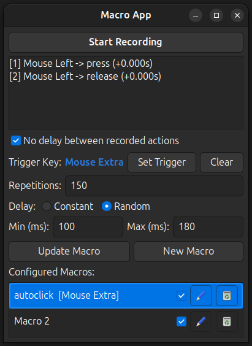

# Macro App

Fast and lightweight macro recorder and autoclicker for Ubuntu 24.04 (Wayland & X11).

**Stack:** C (C99) | Linux Kernel (`/dev/uinput` & `evdev`) | GTK 3 | Ayatana AppIndicator | JSON-C

## What it does
- Records mouse clicks and keyboard inputs with accurate timing.
- Plays back macros with custom repeats and configurable delays (constant or randomized).
- Triggers macros globally via any key or mouse button.
- Runs in the background with a system tray indicator.



## Install & Run
```bash
# Automated setup (dependencies, permissions & build)
chmod +x install.sh
./install.sh

# Compile and run manually
make
./macro_app

# Clean build
make clean
```

## License
MIT License © 2026 Jules Guignard
